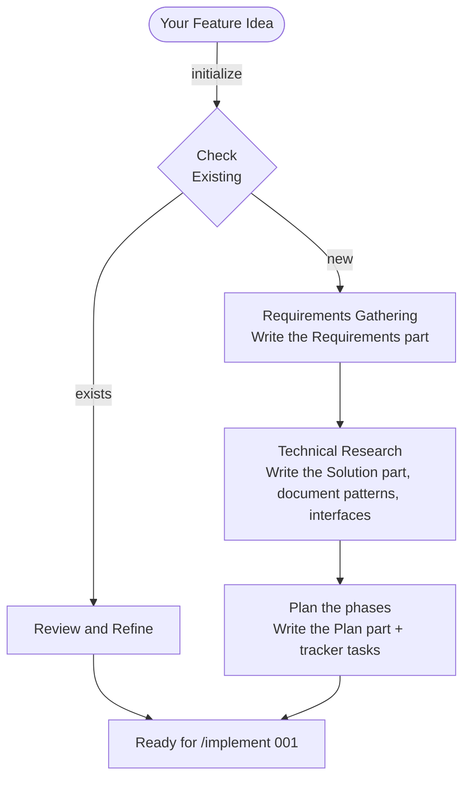
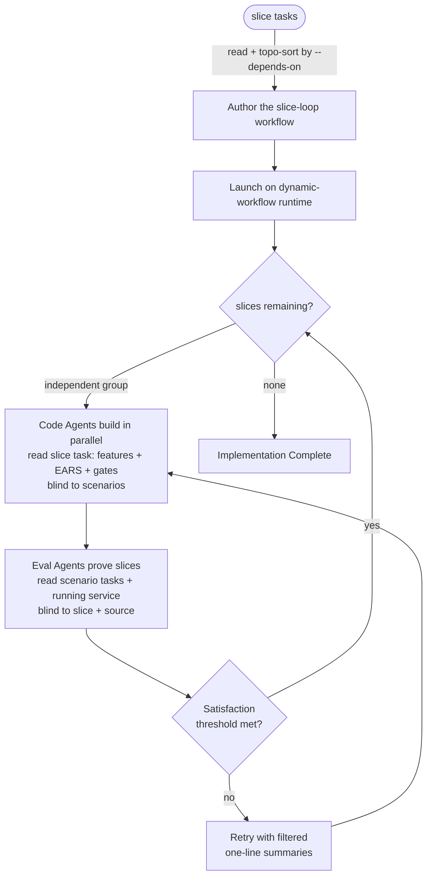
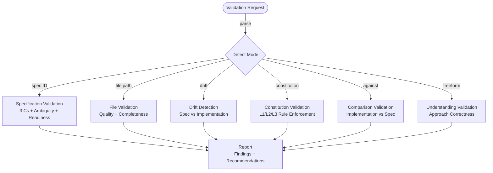
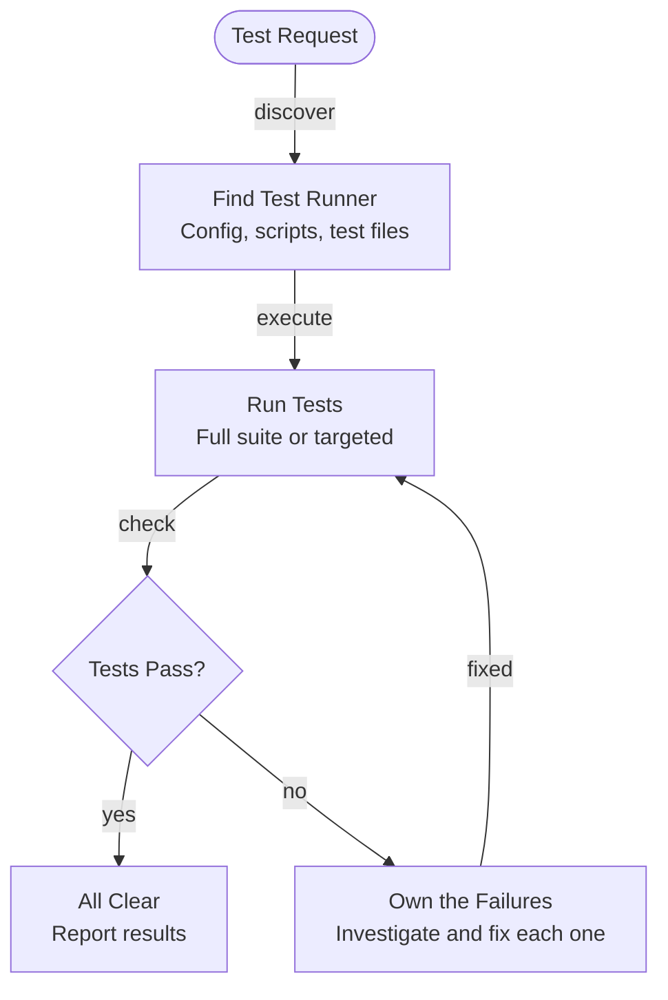
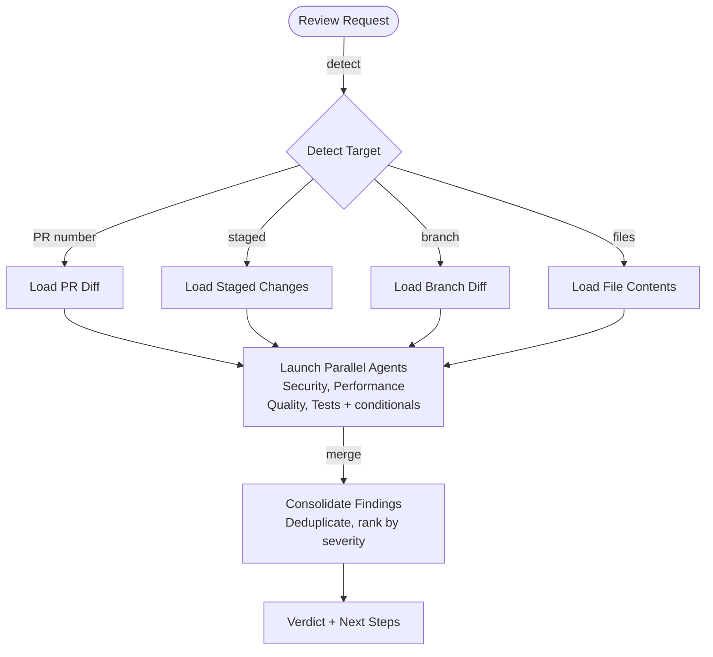
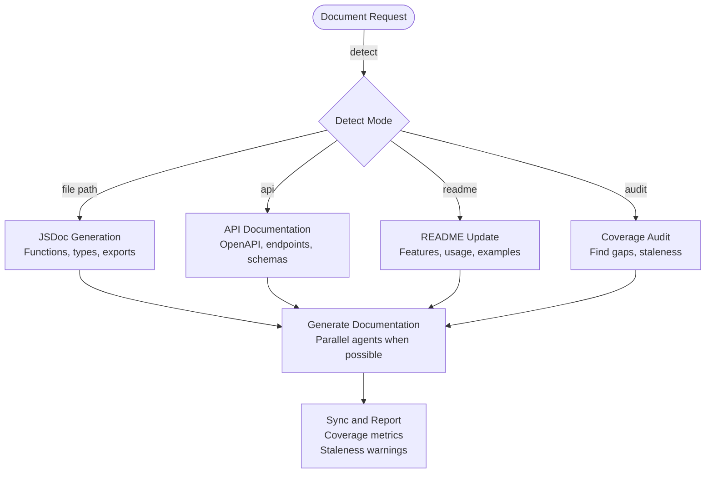
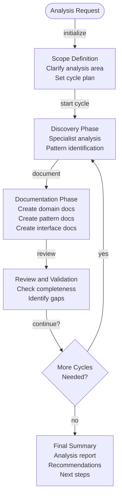
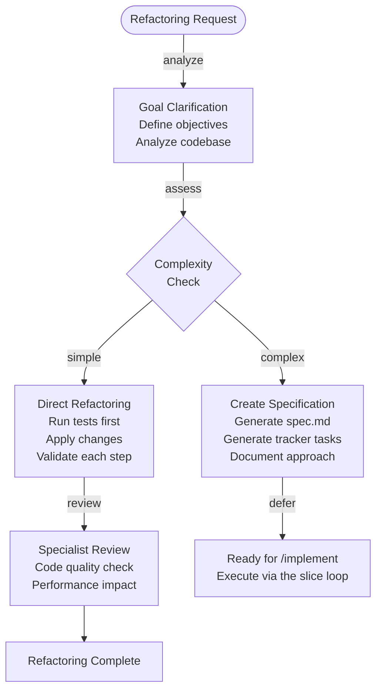
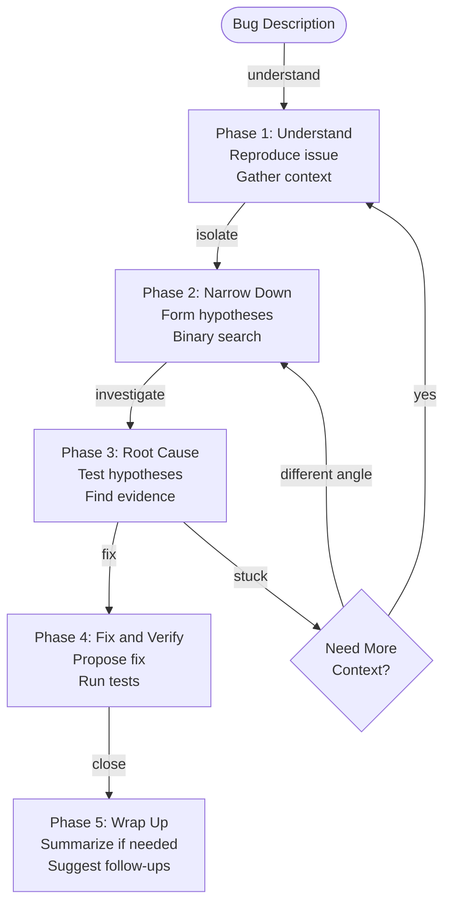
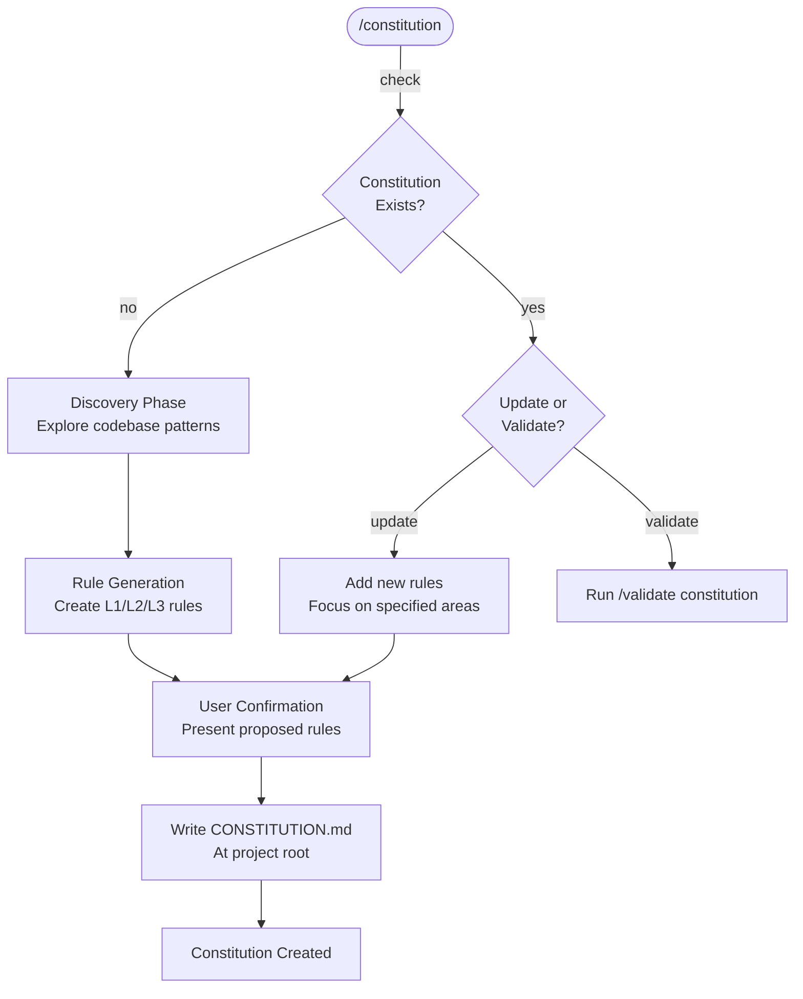

# Start Plugin - The Agentic Startup

**Workflow orchestration plugin for spec-driven development in Claude Code.**

The `start` plugin provides ten user-invocable workflow skills, five autonomous skills, and three output styles to transform how you build software with Claude Code.

**For quick start, workflow guide, and skill selection, see the [main README](../../README.md).**

---

## Table of Contents

- [User-Invocable Skills](#user-invocable-skills) — specify, implement, validate, test, review, document, analyze, refactor, debug, constitution
- [Autonomous Skills](#autonomous-skills) — 5 context-activated skills
- [Documentation Structure](#documentation-structure) — specs, domain, patterns, interfaces
- [Output Styles](#output-styles) — The Garage, The Startup, The ScaleUp
- [Typical Development Workflow](#typical-development-workflow) — primary and maintenance flows
- [Skills in Action](#skills-in-action) — real-world examples
- [Templates](#templates) — PRD, SDD, Plan, Scenario
- [Philosophy](#philosophy) — spec-driven development principles

---

## User-Invocable Skills

These skills are invoked by the user via slash commands (e.g., `/specify`). Unlike autonomous skills which activate automatically based on context, user-invocable skills wait for explicit invocation.

### `/specify <description>`

Create comprehensive specifications from brief descriptions through deep research and specialist agent coordination, producing a narrative plan plus the slice tasks `/implement` runs.

**Purpose:** Transform ideas into implementation-ready specifications with product requirements, solution design, and a plan — one `spec.md` plus the implementation tasks in the tracker

**Usage:**
```bash
/specify Build a real-time notification system with WebSocket support
/specify 001  # Resume existing specification work
```

**Key Features:**
- **Auto-incrementing Spec IDs** - Automatically creates numbered directories (001, 002, etc.)
- **Resume Capability** - Can resume work on existing specifications by ID
- **Sliced Plan** - Slices the work into self-contained slice tasks, each correlating features (ACs), EARS behavior, and quality gates, with holdout scenarios as separate scenario child tasks
- **Dependency-ordered** - slices declare `--depends-on` each other; that graph is the parallelization contract `/implement` uses
- **Pattern Documentation** - Automatically documents discovered patterns in `docs/patterns/`
- **Interface Documentation** - Captures external service contracts in `docs/interfaces/`
- **Domain Documentation** - Records business rules in `docs/domain/`
- **Quality Gates** - Requires user approval between major phases

**Each slice's code brief correlates three facets:**

| Facet | Source | Role |
|-------|--------|------|
| **Features** (acceptance criteria) | Requirements part | what the slice delivers |
| **Behavior** (EARS) | Solution part | how it must behave |
| **Quality Gates** | derived | checkable conditions |

Its **acceptance scenarios** are separate scenario child tasks (holdout evidence) — how it is proven.

<details>
<summary><strong>View Details</strong></summary>

**What you get:** One document, `.start/specs/[NNN]-[name]/spec.md`, in three parts, each closed by its own approval gate:

- **Requirements** - User stories, feature specifications, success criteria, non-functional requirements
- **Solution** - Technical architecture, system components, data models, technology stack
- **Plan** - The target state and the phases with their outcomes; the implementation tasks (phases → slices → scenario child tasks) live in **.tracker/**

Its Ledger part holds the open questions, assumptions, decision log, and accepted review trade-offs.



</details>

---

### `/implement <spec-id>`

Execute a specification by running its slice tasks on Claude Code's dynamic-workflow runtime.

**Purpose:** Transform validated specifications into working code through one loop — each slice built by a code agent and proven by an eval agent, with an information barrier between them and retry to a satisfaction threshold.

**Usage:**
```bash
/implement 001
/implement path/to/custom/spec/
```

**How it works:**

`/implement` reads the spec's slice tasks from the tracker and topologically sorts them by `--depends-on`. It then authors and runs one dynamic workflow:

| Step | What happens |
|------|--------------|
| **Read** | Read the slice tasks (`task.js graph`); each carries a code brief (features + EARS + gates) with its holdout scenarios as scenario child tasks |
| **Launch** | Write the workflow script from the skill's loop contract and run it via the Workflow tool; independent slices run concurrently |
| **Loop** | Per phase: code agents build its slices — one agent for a phase whose slices depend on each other in a chain, one per slice for slices that can run in parallel (they read the slice tasks, blind to the scenarios) → one eval agent proves the phase with a holdout script kept outside the project (it reads the scenario tasks, blind to the slices + source) → retry with filtered summaries until threshold or max iterations |

**Key Features:**
- **One loop, emergent scale** - A 1-slice plan is a short loop; a 40-slice plan fans out. No tier or strategy to choose
- **Structural information barrier** - The barrier is which task each agent reads: code agent → slice task; eval agent → scenario child tasks
- **Resumability** - The dynamic-workflow runtime resumes completed agents from cache within a session
- **Drift Detection** - Runs `Skill(start:validate)` drift checks
- **Constitution Enforcement** - L1/L2 violations block completion
- **Real-time Updates** - `/workflows` shows live per-slice progress

<details>
<summary><strong>View Details — the slice loop</strong></summary>

Reads the spec's slice tasks from the tracker and topologically sorts them by `--depends-on`. Runs a dynamic workflow written from the skill's loop contract. Each phase goes through a barriered code→eval loop: code agents build its slices (reading the slice tasks' features + EARS + gates and AGENTS.md, but never their scenario child tasks), one eval agent proves the phase against those scenario tasks with a holdout script it keeps outside the project (accessing the running service and, for UI scenarios, a real browser, but never the slices or the source), and filtered one-line failure summaries feed the next retry until the satisfaction threshold or max iterations. A phase whose slices form a dependency chain is built by one code agent; slices that can run in parallel get one agent each, concurrently.



</details>

---

### `/validate <target>`

Validate specifications, implementations, or understanding through intelligent context detection and the 3 Cs framework (Completeness, Consistency, Correctness).

**Purpose:** Quality gate that works at any lifecycle stage - during specification, before implementation, or after completion

**Usage:**
```bash
/validate 001                                          # Validate spec by ID
/validate .start/specs/001/spec.md                      # Validate specific file
/validate Check the auth implementation against SDD    # Compare implementation to spec
/validate drift                                        # Check for spec-implementation drift
/validate constitution                                 # Validate constitution compliance
/validate Is my caching approach correct?              # Validate understanding
```

**Key Features:**
- **Intelligent Mode Detection** - Automatically determines validation type from input
- **The 3 Cs Framework** - Checks Completeness, Consistency, and Correctness
- **Ambiguity Detection** - Scans for vague language ("should", "various", "etc.")
- **Cross-Document Traceability** - Verifies requirements to solution to manifest alignment
- **Drift Detection** - Checks spec-implementation alignment
- **Constitution Enforcement** - Validates L1/L2/L3 governance rules
- **Advisory Only** - Provides recommendations without blocking
- **Comparison Validation** - Compares implementations against specifications

<details>
<summary><strong>View Details</strong></summary>

**Six validation modes** automatically detected from input:

| Input Type | Mode | What Gets Validated |
|------------|------|---------------------|
| Spec ID (`005`) | Specification | Full spec quality and readiness |
| File path (`src/auth.ts`) | File | Individual file quality |
| `drift` or `check drift` | Drift Detection | Spec-implementation alignment |
| `constitution` | Constitution | Governance rule compliance |
| "Check X against Y" | Comparison | Implementation vs specification |
| Freeform text | Understanding | Approach correctness |

**The 3 Cs Framework:**

1. **Completeness** - All sections filled, no `[NEEDS CLARIFICATION]` markers, checklists complete
2. **Consistency** - Cross-document traceability, terminology alignment, no contradictions
3. **Correctness** - ADRs confirmed, dependencies valid, acceptance criteria testable



</details>

---

### `/test [target]`

Run tests with strict code ownership enforcement — no "pre-existing failures" excuses allowed.

**Purpose:** Discover and execute tests, ensure the codebase is left in a passing state, and enforce ownership of any failures encountered

**Usage:**
```bash
/test                            # Run full test suite
/test all                        # Run full test suite (explicit)
/test src/auth/                  # Run tests for specific path
/test baseline                   # Capture current test state
```

**Key Features:**
- **Test Discovery** - Automatically finds test runner, config, and test files
- **Code Ownership** - If tests fail, you own the fix — no blaming pre-existing issues
- **Baseline Capture** - Record current passing/failing state before changes
- **Multi-Agent Parallel** - Can distribute test suites across parallel agents
- **Targeted Execution** - Run specific test files, directories, or the full suite

<details>
<summary><strong>View Details</strong></summary>

**The Ownership Mandate:**

When tests fail, the skill enforces strict ownership:
- No "these were pre-existing failures"
- No "not caused by my changes"
- No leaving failing tests for the user

**Test Modes:**

| Input | Mode | What Happens |
|-------|------|--------------|
| (empty) or `all` | Full Suite | Discovers and runs all tests |
| File/directory path | Targeted | Runs tests for specific scope |
| `baseline` | Capture | Records current test state for comparison |



</details>

---

### `/review [target]`

Multi-agent code review with specialized perspectives running in parallel.

**Purpose:** Comprehensive code review before merging, with specialized agents examining different concerns simultaneously

**Usage:**
```bash
/review                          # Review staged changes
/review 123                      # Review PR number
/review feature/auth             # Review branch changes
/review src/auth/ src/users/     # Review specific files/directories
/review staged                   # Explicitly review staged changes
```

**Key Features:**
- **Parallel Specialists** - Security, Performance, Quality, and Test agents review simultaneously
- **Conditional Perspectives** - Concurrency, Dependencies, Compatibility, Accessibility activate when relevant
- **Target Auto-Detection** - Detects PR number, staged changes, file path, or branch diffs
- **Confidence Scoring** - Each finding includes confidence level (HIGH/MEDIUM/LOW)
- **Severity Classification** - CRITICAL, HIGH, MEDIUM, LOW findings
- **Standard or Team Mode** - Fire-and-forget subagents or persistent teammates with coordination

<details>
<summary><strong>View Details</strong></summary>

**Core Review Perspectives (always active):**

| Perspective | Focus Areas |
|-------------|-------------|
| **Security** | SQL injection, XSS, hardcoded secrets, auth bypasses, input validation |
| **Performance** | N+1 queries, missing indexes, memory leaks, inefficient algorithms |
| **Quality** | Code complexity, naming, SOLID principles, error handling, duplication |
| **Tests** | Coverage gaps, missing edge cases, test quality, assertion completeness |

**Conditional Perspectives (activated when relevant):**

| Perspective | Trigger |
|-------------|---------|
| **Concurrency** | async/await, Promise, threading detected |
| **Dependencies** | Dependency file changes |
| **Compatibility** | Public API or schema changes |
| **Accessibility** | Frontend component changes |
| **Constitution** | CONSTITUTION.md exists in project |



</details>

---

### `/document [target]`

Generate and sync documentation including API docs, READMEs, JSDoc comments, and documentation audits.

**Purpose:** Keep documentation current with code, generate missing docs, and identify staleness

**Usage:**
```bash
/document src/api/               # Generate API documentation
/document readme                 # Update project README
/document src/utils/             # Add JSDoc to code files
/document audit                  # Audit documentation coverage
```

**Key Features:**
- **Multiple Documentation Modes** - Code, API, README, Audit, Module
- **Staleness Detection** - Identifies outdated documentation
- **Coverage Metrics** - Reports documentation completeness percentage
- **OpenAPI Generation** - Creates OpenAPI/Swagger specs from API code
- **Multi-Agent Parallel** - Multiple documentation agents work simultaneously

<details>
<summary><strong>View Details</strong></summary>

**Documentation Modes:**

| Input | Mode | Output |
|-------|------|--------|
| File/directory path | Code | JSDoc/TSDoc comments |
| `api` | API | OpenAPI spec, endpoint docs |
| `readme` | README | README.md updates |
| `audit` | Audit | Coverage report |

**Staleness Detection:**

The skill automatically detects when documentation is outdated by:
- Comparing doc timestamps to code changes
- Checking if documented APIs still match implementation
- Identifying undocumented new exports



</details>

---

### `/analyze <area>`

Discover and document business rules, technical patterns, and system interfaces through iterative exploration.

**Purpose:** Extract organizational knowledge from existing codebase and create reusable documentation

**Usage:**
```bash
/analyze security patterns in authentication
/analyze business rules for user permissions
/analyze technical patterns in our microservices architecture
```

<details>
<summary><strong>View Details</strong></summary>

Uses cyclical discovery-documentation-review workflow to extract organizational knowledge. Specialist agents explore the codebase to identify patterns, rules, and interfaces across business, technical, security, performance, integration, data, testing, and deployment areas. Documentation is automatically organized into `docs/domain/`, `docs/patterns/`, and `docs/interfaces/` directories.



</details>

---

### `/refactor <description>`

Improve code quality while strictly preserving all existing behavior through test-validated incremental changes.

**Purpose:** Safe, systematic refactoring with automatic rollback on test failures

**Usage:**
```bash
/refactor Simplify the authentication middleware for better testability
/refactor Improve the WebSocket connection manager
```

<details>
<summary><strong>View Details</strong></summary>

Strictly preserves behavior through test-validated incremental changes. All tests must pass before refactoring begins and after each change. Automatic rollback on test failures. For simple refactorings, applies changes directly with continuous validation. For complex refactorings, creates specification documents and defers to `/implement` for planned execution.



</details>

---

### `/debug <description>`

Diagnose and resolve bugs through conversational investigation with systematic root cause analysis.

**Purpose:** Natural language debugging partner that helps identify and fix issues through dialogue, not rigid procedures

**Usage:**
```bash
/debug The API returns 500 errors when uploading large files
/debug Tests are failing intermittently on CI but pass locally
/debug Users report slow page loads after the latest deployment
```

**Key Features:**
- **Conversational Flow** - Natural dialogue, not rigid checklists or procedures
- **Progressive Disclosure** - Starts with summary, reveals details on request
- **Observable Actions Only** - Reports only what was actually checked and found
- **User-Driven** - Proposes next steps, lets user guide the direction
- **Hypothesis Tracking** - Forms and tests ranked hypotheses systematically
- **Evidence-Based** - Never fabricates reasoning; all conclusions backed by evidence

<details>
<summary><strong>View Details</strong></summary>

Uses a conversational approach through five natural phases: understand the problem, narrow it down, find the root cause, fix and verify, wrap up. The debugger reports only observable actions ("I checked X and found Y") and never fabricates reasoning. Users can ask "what did you check?" at any point and receive honest, verifiable answers.



**The Four Commandments:**
1. **Conversational, not procedural** - It's a dialogue, not a checklist
2. **Observable only** - "I looked at X and found Y" not "This is probably..."
3. **Progressive disclosure** - Start brief, expand on request
4. **User in control** - "Want me to...?" not "I will now..."

</details>

---

### `/constitution [focus-areas]`

Create or update a project constitution with governance rules through discovery-based pattern analysis.

**Purpose:** Establish checkable project rules that are enforced during implementation, review, and validation

**Usage:**
```bash
/constitution                                    # Create new constitution via codebase discovery
/constitution security and testing               # Focus on specific areas
/constitution Add API patterns                   # Update existing constitution
```

**Key Features:**
- **Discovery-Based Rules** - Analyzes actual codebase patterns, never assumes frameworks
- **L1/L2/L3 Level System** - L1 (blocking + autofix), L2 (blocking, manual), L3 (advisory)
- **Three-Layer Enforcement** - Checked during specify (SDD), implement, and review
- **Pattern + Check Rules** - Supports regex patterns and semantic LLM-interpreted checks
- **Graceful Degradation** - System works normally if no constitution exists

<details>
<summary><strong>View Details</strong></summary>

Creates `CONSTITUTION.md` at project root (like README, LICENSE, CODE_OF_CONDUCT). The constitution defines checkable guardrails that detect violations during development.

**Key Distinction:**
- **CLAUDE.md** = Project description, AI guidance ("Use React with TypeScript")
- **CONSTITUTION.md** = Checkable rules that catch violations ("No barrel exports")

**Level Definitions:**

| Level | Name | Blocking | Autofix | Use Case |
|-------|------|----------|---------|----------|
| **L1** | Must | Yes | AI auto-corrects | Security, correctness, critical architecture |
| **L2** | Should | Yes | No | Important rules requiring human judgment |
| **L3** | May | No | No | Style preferences, suggestions |

**Rule Format Example:**

```markdown
### No Hardcoded Secrets

\```yaml
level: L1
pattern: "(api_key|secret|password)\\s*[:=]\\s*['\"][^'\"]{8,}['\"]"
scope: "**/*.{ts,js}"
exclude: "**/*.test.*, .env.example"
message: Hardcoded secret detected. Use environment variables.
\```

Secrets must never be committed to source control.
```

**Three-Layer Enforcement:**

| Phase | Command | Enforcement |
|-------|---------|-------------|
| **Planning** | `/specify` (SDD) | SDD must not violate constitutional principles |
| **Task** | `/implement` | Task ordering respects constitutional priorities |
| **Implementation** | `/implement` | Generated code checked; L1/L2 violations block completion |



</details>

---

### Installation

Install The Agentic Startup framework with the interactive installer:

```bash
npx the-startup
```

**What it does:**
- Supports both Claude marketplace installs and file-based installs for other harnesses
- Prompts for plugin multi-select
- Prompts for harness + installation path when using file install mode
- Copies file-install artifacts from the remote GitHub repository

**Flags:**
- `--help` - Show usage information

**Note:** Output styles are selected via `/config` — see [Output Styles](#output-styles).

---

## Autonomous Skills

The `start` plugin includes five autonomous skills that activate automatically based on context. You never need to explicitly invoke them — they work when needed.

### Specification Skills

| Skill | Purpose |
|-------|---------|
| `specify-meta` | Spec directory creation, README tracking, phase transitions |
| `specify-requirements` | Product requirements template, validation, requirements gathering |
| `specify-solution` | Solution design template, architecture design, ADR management |
| `specify-plan` | Authors the narrative plan + the slice and scenario tasks in the tracker |

### Implementation Skills

| Skill | Purpose |
|-------|---------|
| `implement` | Runs the slice loop as a dynamic workflow — barriered code→eval retry per slice |

---

## Documentation Structure

The plugin encourages structured knowledge management:

```
.start/
└── specs/
    └── [3-digit-number]-[feature-name]/
        ├── spec.md                          # Requirements, Solution, Plan parts + Ledger
        ├── review.md                        # Solution review report
        └── .tracker/                        # Implementation tasks (phase → slices → scenarios)

docs/
├── domain/                                  # Business rules
│   ├── user-permissions.md
│   ├── order-workflow.md
│   └── pricing-rules.md
│
├── patterns/                                # Technical patterns
│   ├── authentication-flow.md
│   ├── caching-strategy.md
│   └── error-handling.md
│
└── interfaces/                              # External integrations
    ├── stripe-payments.md
    ├── sendgrid-webhooks.md
    └── oauth-providers.md
```

### Auto-Documentation

The `document` skill's Capture perspective automatically creates files in the correct location when patterns, interfaces, or domain rules are discovered during:
- Specification creation (`/specify`)
- Implementation (`/implement`)
- Analysis (`/analyze`)

### Deduplication

The capture workflow always checks existing documentation before creating new files, preventing duplicates.

---

## Output Styles

The `start` plugin ships three output styles — one register per company stage. A style changes how
Claude communicates and how much process it applies, not what it knows. All three keep Claude Code's
built-in engineering instructions (`keep-coding-instructions: true`), and a style shapes the main
conversation only — subagents and the plugin's workflows are unaffected.

Pick the register that matches who the work is for:

| Style | Register | Reach for it when |
|-------|----------|-------------------|
| **The Garage** | Pre-startup — build the least thing that works, say the least about it | Prototypes and spikes; nothing is load-bearing yet, you are finding out whether the thing works |
| **The Startup** | Solo — one engineer, one agent, no ceremony | It is just you; no delegation, no plan-for-approval theater, no status for third parties |
| **The ScaleUp** | Coordinated — work that moves through other people | Someone who was not in the conversation will read what you write and touch what you change; delegate and leave a trail |

### Activating a style

The `/output-style` command was removed in Claude Code v2.1.91. Current ways to select:

- **Interactive:** `/config` → Output style.
- **Direct:** `/config outputStyle=The Startup` (Claude Code v2.1.181+).
- **Pinned for a project** (shared with the team via git) in `.claude/settings.json`:

  ```json
  { "outputStyle": "The Garage" }
  ```

  Use `.claude/settings.local.json` for a personal per-project choice, or `~/.claude/settings.json`
  for all projects. Precedence: local > project > user. A change takes effect on the next session
  (or after `/clear`).

This plugin deliberately does **not** force a style (`force-for-plugin` is unset on all three): the
stage is your call, and a forced style would override both your `/config` selection and any settings
pin for as long as the plugin is enabled.

---

## Typical Development Workflow

### Setup (Optional)

```
/constitution ──> Create project governance rules
                  L1/L2/L3 rules auto-enforced in BUILD flow
                  CONSTITUTION.md at project root
```

### Primary Workflow: Specify > Validate > Implement > Review

```
/specify ──> /validate ──> /implement ──> /review
   |              |              |              |
Create specs  Check quality  slice loop    Code review
PRD+SDD+Plan  3 Cs framework  code↔eval     Security+Perf
   |              |              |              |
Constitution  Constitution   Constitution   Constitution
checked on    mode available + drift enforced compliance
SDD

Optional: /document after implementation for documentation sync
```

*If `CONSTITUTION.md` exists, rules are automatically checked at each stage.*

**1. Create Specification**

```bash
/specify Add real-time notification system with WebSocket support
```

**What happens:**
- Creates `.start/specs/001-notification-system/`
- Generates spec.md and the tracker tasks
- Documents discovered patterns/interfaces
- Optional: Creates `spec/001-notification-system` git branch

**2. Validate Before Implementation (Recommended)**

```bash
/validate 001
```

**What happens:**
- Checks completeness, consistency, correctness (3 Cs)
- Detects ambiguities and vague language
- Security scanning for common vulnerabilities
- Verifies cross-document traceability

**3. Execute Implementation**

```bash
/implement 001
```

**What happens:**
- Optional: Creates `feature/001-notification-system` git branch
- Runs the slice loop as a dynamic workflow
- Per slice: a code agent builds it, an eval agent proves it against holdout scenario tasks
- Retries with filtered failure summaries until the satisfaction threshold is met
- Optional: Creates PR at completion

**4. Review Before Merge**

```bash
/review
```

**What happens:**
- Parallel specialists review (Security, Performance, Quality, Tests + conditionals)
- Generates consolidated report with severity rankings

**5. Generate Documentation (Optional)**

```bash
/document src/notifications/
```

**What happens:**
- Adds JSDoc/TSDoc comments
- Updates README if needed
- Reports documentation coverage

---

### Maintenance Workflows

**Understand Existing Code**

```bash
/analyze security patterns in authentication
```

Documents findings in `docs/patterns/`, `docs/domain/`, `docs/interfaces/`

**Refactoring**

```bash
/refactor Restructure the authentication module for better testability
```

For architectural changes - creates specs, plans migration, handles breaking changes.

**Fix Bugs**

```bash
/debug The notification system stops working after 100 concurrent users
```

Conversational investigation with observable evidence and user-driven direction.

**Audit Documentation**

```bash
/document audit
```

Reports documentation coverage and identifies stale or missing docs.

---

## Skills in Action

### Example: Knowledge Capture via Document Skill

**Scenario:** During implementation, an agent discovers a pattern

```
Agent output: "I implemented a retry mechanism with exponential backoff for API calls"
```

**What happens automatically:**
1. Document skill's Capture perspective activates
2. Checks `docs/patterns/` for existing retry patterns
3. Not found — Creates `docs/patterns/api-retry-strategy.md`
4. Uses pattern template
5. Reports: "Created docs/patterns/api-retry-strategy.md"

**You didn't have to:** Manually request documentation or specify the path

---

## Templates

Rich templates for structured documentation, co-located with their skills:

```
plugins/start/skills/
├── specify-requirements/template.md     # Product requirements structure
├── specify-solution/template.md         # Solution design structure
├── specify-plan/template.md               # Plan structure (narrative: phases + outcomes)
├── specify-plan/templates/scenario.md      # Holdout scenario-task body template
└── document/templates/                  # Knowledge capture templates
    ├── domain-template.md               # Business rules
    ├── pattern-template.md              # Technical patterns
    └── interface-template.md            # External integrations
```

**Usage:** Automatically used by `/specify` and `/document` when creating documentation

---

## Philosophy

### Spec-Driven Development

**The problem:** Features built without clear requirements lead to technical debt, rework, and inconsistency.

**Our approach:**

1. **Specify First** - Comprehensive specifications before code
2. **Review & Refine** - Validate with stakeholders
3. **Implement with Confidence** - Execute validated plans
4. **Document & Learn** - Capture patterns for reuse

### Core Principles

- **Measure twice, cut once** - Upfront planning saves time
- **Documentation as code** - Specs evolve with your codebase
- **Parallel execution** - Multiple specialists, clear boundaries
- **Quality gates** - DOR/DOD enforce standards
- **Progressive disclosure** - Load details only when needed

---

## Further Reading

- **[Main README](../../README.md)** - Project overview and installation
