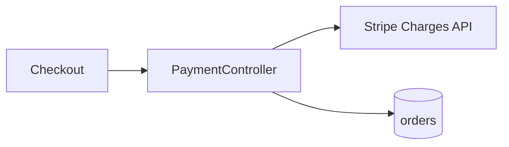

# 004-payment-processing

**Commit:** 3f9c2a1 — feat(payments): synchronous Stripe charges at checkout

## What this is
Card payments at checkout through Stripe, so orders are paid online instead of by manual invoice.

## Architecture

The checkout calls `PaymentController`, which creates a Stripe charge synchronously and marks the order paid in the same request.

## Implementation
- `src/payments/payment-controller.ts` — charge creation and order update
- `src/payments/stripe-client.ts` — thin Charges API wrapper
