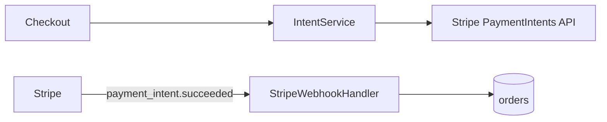

# Solution Design Document

## Approach

Replace the synchronous Charges flow with Stripe PaymentIntents: checkout creates an intent with an idempotency key per order, the client confirms it (handling 3-D Secure), and a webhook handler marks the order paid. `PaymentController` and `stripe-client.ts` from spec 004 are removed.

- **Cross-cutting:** webhook signature verification; idempotency key = order ID
- **Deployment:** new webhook endpoint registered in Stripe

## Read first

| Source | Why it matters |
|--------|----------------|
| `src/payments/payment-controller.ts` | Flow being replaced |

## Boundaries

- **Must preserve:** order status values
- **Can modify:** everything under `src/payments/`
- **Must not touch:** refunds

## Components

| Component | Responsibility | Owns |
|-----------|----------------|------|
| IntentService | Creates or reuses a PaymentIntent per order | AC-1.1 |
| StripeWebhookHandler | Verifies events and marks orders paid idempotently | AC-1.2 |



```
src/payments/
├── intent-service.ts          # NEW
├── stripe-webhook-handler.ts  # NEW
├── payment-controller.ts      # DELETE
└── stripe-client.ts           # DELETE
```

## Interfaces & data

| Name | Direction | Type / format | Auth | Contract |
|------|-----------|---------------|------|----------|
| `POST /api/orders/{id}/payment-intent` | inbound | HTTPS / JSON | session | → `{clientSecret}` |
| `POST /webhooks/stripe` | inbound | HTTPS / JSON | Stripe signature | `payment_intent.succeeded` |

## Runtime

Checkout requests an intent; the client confirms it with Stripe.js; Stripe sends `payment_intent.succeeded`; the handler marks the order paid if not already paid.

## Decisions

> [!IMPORTANT]
> **Decision (ADR-1): Payment flow → PaymentIntents with webhook confirmation**
>
> | Option | Trade-off / why (not) |
> |--------|-----------------------|
> | **PaymentIntents + webhook** | Supports 3-D Secure; idempotent |
> | Keep Charges with retries | Cannot do 3-D Secure |
>
> **Rationale:** Only option supporting SCA · **Accepts:** asynchronous order status
>
> - [x] User confirmed

## Behavior

**Main flow — AC-1.1:**
- [ ] WHEN the customer completes 3-D Secure, THE SYSTEM SHALL mark the order paid on `payment_intent.succeeded`

**Edge cases — AC-1.2:**
- [ ] IF a `payment_intent.succeeded` event arrives for an already paid order, THEN THE SYSTEM SHALL ignore it

## Risks & gotchas

- Webhooks can arrive before the client redirect; the UI polls order status.

## Open questions

None — all decisions settled.
