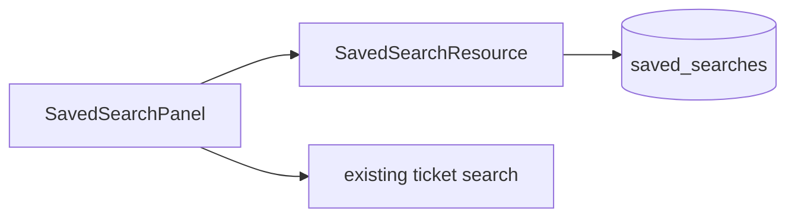

# Solution Design Document

## Approach

Saved searches are stored as JSON filter objects in a new table and served by a small REST resource in the existing ticketing API; the web client reuses its current filter state serializer.

- **Cross-cutting:** per-agent ownership enforced in the query; no PII stored
- **Deployment:** one migration

## Read first

| Source | Why it matters |
|--------|----------------|
| `api/tickets/search.ts` | Existing filter model and query builder |
| `web/src/tickets/filters.ts` | Filter state serializer reused by the client |

## Boundaries

- **Must preserve:** the ticket search endpoint contract
- **Can modify:** ticket list sidebar
- **Must not touch:** ticket permissions

## Components

| Component | Responsibility | Owns |
|-----------|----------------|------|
| SavedSearchResource | CRUD for an agent's saved searches; name uniqueness; 50-item limit | FR-1 |
| SavedSearchPanel | Lists saved searches and applies one to the ticket list | FR-2 |



## Interfaces & data

| Name | Direction | Type / format | Auth | Contract |
|------|-----------|---------------|------|----------|
| `GET/POST /api/saved-searches` | inbound | HTTPS / JSON | session | list; `{name, filters}` → `201` or `409 name_taken` |
| `PUT/DELETE /api/saved-searches/{id}` | inbound | HTTPS / JSON | session | overwrite / delete own search |

```yaml
Table: saved_searches (NEW)
  id: uuid primary key
  agent_id: foreign key → agents.id
  name: text not null
  filters: jsonb not null
  UNIQUE (agent_id, name)
```

## Runtime

The agent saves filters; the resource validates name uniqueness and the limit and stores them. Selecting a saved search loads its filters into the client and runs the existing ticket search.

## Decisions

> [!IMPORTANT]
> **Decision (ADR-1): Filter storage → JSONB of the client filter state**
>
> | Option | Trade-off / why (not) |
> |--------|-----------------------|
> | **JSONB** | Reuses the existing serializer; no schema per filter |
> | Normalized filter rows | Queryable but duplicates the filter model |
>
> **Rationale:** Filters are only replayed, never queried · **Accepts:** migrations if the filter format changes
>
> - [x] User confirmed

## Behavior

**Main flow — AC-1.1:**
- [ ] WHEN an agent saves filters with a new name, THE SYSTEM SHALL store them and return the saved search

**Error handling — AC-1.2:**
- [ ] IF the name already exists for that agent, THEN THE SYSTEM SHALL respond `409 name_taken`

**Main flow — AC-2.1:**
- [ ] WHEN an agent selects a saved search, THE SYSTEM SHALL run the ticket search with its stored filters

## Risks & gotchas

- Filter format changes break old saved searches; version the JSON.

## Open questions

None — all decisions settled.
