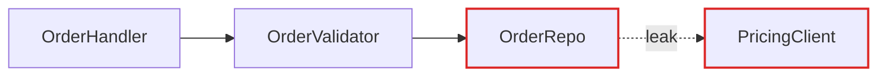
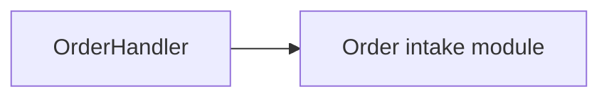

# Markdown Report Format

The architectural review is a single markdown file written to `.start/architecture-reviews/` — never to `docs/` or a source tree (only an agreed deepening graduates to `docs/patterns/`). Mermaid fenced blocks carry the before/after diagrams; they render in GitHub, most IDEs, and markdown previewers. The diagrams do the work — prose is sparse, plain, and uses the glossary terms (language.md) without ceremony.

## Structure

```markdown
# Architecture review — {{repo name}}
_{{date}}_

> **Legend** — module · seam (where the interface lives) · leakage (logic crossing a seam it shouldn't) · deep (much behaviour behind a small interface) · shallow (interface nearly as complex as its implementation).

## Candidates
<!-- one ## section per candidate -->

## Top recommendation
<!-- which candidate to tackle first, and one sentence on why -->
```

No introduction paragraph — straight into the candidates.

## Candidate section

Each candidate is one `## ` section:

- **Title** (the heading) — short, names the deepening (e.g. "Collapse the Order intake pipeline").
- **Strength + category line** — recommendation strength (`Strong`, `Worth exploring`, `Speculative`) and the dependency category (`in-process`, `local-substitutable`, `ports & adapters`, `mock`), as a single bold line: `**Strong** · ports & adapters`.
- **Files** — a short list in backticks.
- **Before / After diagram** — the centrepiece. Two Mermaid blocks (or one with a clear split). See patterns below.
- **Problem** — one sentence. What hurts.
- **Solution** — one sentence. What changes.
- **Wins** — bullets, ≤6 words each, in glossary terms. e.g. "locality: bugs concentrate in one module", "leverage: one interface, N call sites", "delete 4 shallow wrappers".
- **ADR callout** (if applicable) — one line in a `> ` blockquote, prefixed `⚠️ ADR:`.

No paragraphs of explanation. If the diagram needs a paragraph to be understood, redraw the diagram.

## Diagram patterns

Pick the pattern that fits the candidate. Mix them — don't make every diagram look the same.

### Mermaid graph (the workhorse for dependencies / call flow)

Use a `flowchart` or `graph` when the point is "X calls Y calls Z, and look at the mess." Style with `classDef` to colour leakage edges red. Sequence diagrams work well for "before: 6 round-trips; after: 1."

````markdown
**Before**


**After**

````

### Cross-section (good for layered shallowness)

A Mermaid `flowchart TB` stack showing the layers a call passes through. Before: many thin layers each doing nothing. After: one band labelled with the consolidated responsibility.

### Mass diagram (good for "interface as wide as implementation")

When a graph won't convey "the interface is nearly as wide as the implementation", fall back to a small two-column markdown table per module — one column for interface surface, one for implementation — or describe the ratio in a one-line caption. Don't force Mermaid to draw proportional rectangles.

### Call-graph collapse

Before: a tree of function calls as a Mermaid graph. After: the same tree collapsed into one node, with the now-internal calls noted in a caption as "absorbed".

## Top recommendation section

One short section. Candidate name (as a markdown link to its `##` heading anchor), one sentence on why. That's it.

## Tone

Plain English, concise — but the architectural nouns and verbs come straight from language.md. Concision is not an excuse to drift.

**Use exactly:** module, interface, implementation, depth, deep, shallow, seam, adapter, leverage, locality.

**Never substitute:** component, service, unit (for module) · API, signature (for interface) · boundary (for seam) · layer, wrapper (for module, when you mean module).

**Phrasings that fit the style:**

- "Order intake module is shallow — interface nearly matches the implementation."
- "Pricing leaks across the seam."
- "Deepen: one interface, one place to test."
- "Two adapters justify the seam: HTTP in prod, in-memory in tests."

**Wins bullets** name the gain in glossary terms: *"locality: bugs concentrate in one module"*, *"leverage: one interface, N call sites"*, *"interface shrinks; implementation absorbs the wrappers"*. Don't write *"easier to maintain"* or *"cleaner code"* — those aren't in the glossary and don't earn their place.

No hedging, no throat-clearing, no "it's worth noting that…". If a sentence could be a bullet, make it a bullet. If a bullet could be cut, cut it. If a term isn't in language.md, reach for one that is before inventing a new one.
