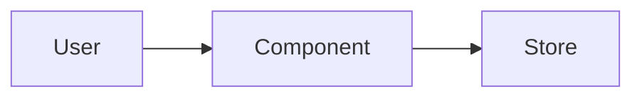

# [NEEDS CLARIFICATION: Feature title]

> [!NOTE]
> One document, three parts, each closed by its own approval gate (the `gates` frontmatter:
> `pending` → `draft` → `approved`). **Requirements** answer WHY and WHAT, **Solution** answers HOW,
> **Plan** names the phases and their slices. The slice code briefs and holdout scenarios live in
> `.tracker/`, never here. Every fact is written once and referenced by its id everywhere else:
> features `FR-N`, criteria `AC-N.M`, quality gates `NFR-N`, data `DR-N`, decisions `ADR-N`,
> assumptions `An` — ids are permanent once assigned; the slice tasks trace them.

## Requirements

### Problem

[NEEDS CLARIFICATION: What specific problem do people face today, who has it, and what is the evidence? What does it cost them — and us — to leave it unsolved?]

### Outcome

[NEEDS CLARIFICATION: One paragraph. What is true for users once this ships, and why will they choose it over what they do now? This is the "done" the whole spec is measured against.]

### Who

Everyone with a stake — those who use it and those whose week changes when it ships. One row per distinct goal or concern.

| Role | Relationship | Goal or concern today | What success looks like for them |
|------|--------------|-----------------------|----------------------------------|
| [NEEDS CLARIFICATION: e.g. Claims handler] | uses it | [what they are trying to do and what gets in the way] | [their acceptance condition] |

### Features

Each feature is one distinct capability, stated once. Acceptance criteria are Gherkin — `Given / When / Then`, one testable condition each, covering the happy path, the error path, and the edge case. A criterion that rests on a Standing assumption cites it as `[ASSUMPTION An]`.

#### Must have

##### FR-1: [NEEDS CLARIFICATION: Feature name]
- **User story:** As a [role], I want to [action] so that [benefit]
- **Acceptance criteria:**
  - [ ] **AC-1.1** — Given [state], When [action], Then [observable outcome]
  - [ ] **AC-1.2** — Given [edge case], When [action], Then [correct behavior]

#### Should have

[NEEDS CLARIFICATION: Same FR / AC structure, or "None".]

#### Won't have (this phase)

[NEEDS CLARIFICATION: What is explicitly out of scope — especially capabilities a reader could confuse with the ones above?]

### Quality gates

One row per quality concern a tester who does not know the implementation can measure. The mechanism belongs in Solution.

| ID | Concern | Requirement (user-observable) | Gate (measurable) |
|----|---------|-------------------------------|-------------------|
| NFR-1 | [NEEDS CLARIFICATION: e.g. Performance] | [e.g. Status lookups feel instant] | [e.g. p95 response < 300 ms at 1,000 concurrent users] |

### Data

What the feature collects and keeps, as an obligation. Omit this section only when the feature holds no personal or sensitive data.

| ID | Data item | Purpose | Retention | Classification |
|----|-----------|---------|-----------|----------------|
| DR-1 | [NEEDS CLARIFICATION: e.g. Customer email] | [e.g. receipt delivery] | [e.g. life of account + 90 days] | [PII / sensitive / internal / public] |

- **User rights:** [NEEDS CLARIFICATION: How do users view, export, correct, or delete this data?]

### Constraints & dependencies

- [NEEDS CLARIFICATION: Budget, timeline, platform, legal, or compliance limits on the solution space]

| Dependency | Owner | Needed by | Impact if late |
|------------|-------|-----------|----------------|
| [NEEDS CLARIFICATION: e.g. Vendor API access] | [team / vendor] | [phase or date] | [what slips or degrades] |

### Glossary

Only the domain terms a new team member would stumble on. "None" is a valid entry.

| Term | Definition |
|------|------------|
| [NEEDS CLARIFICATION: term] | [Single authoritative definition] |

## Solution

### Approach

[NEEDS CLARIFICATION: One paragraph. The architecture pattern, how the feature integrates with the current system, and why this fits the requirements. Add any purely technical constraint the requirements do not carry.]

- **Cross-cutting:** [one line each where relevant — security, error handling, performance, observability]
- **Deployment:** [NEEDS CLARIFICATION: "No change", or what changes]

### Read first

Context the implementer must read before building. Real paths only; one line on why each matters. "None — new project." is valid.

| Source | Why it matters |
|--------|----------------|
| [NEEDS CLARIFICATION: e.g. `src/claims/status.py`] | [e.g. the module being extended] |

### Boundaries

- **Must preserve:** [NEEDS CLARIFICATION: behavior and interfaces that cannot change]
- **Can modify:** [areas open for change]
- **Must not touch:** [files or systems that are off-limits]

### Components

[NEEDS CLARIFICATION: The components this feature adds or changes and how they interact.]

| Component | Responsibility | Owns |
|-----------|----------------|------|
| [NEEDS CLARIFICATION: name] | [one distinct responsibility] | [FR-N, NFR-N it owns — each requirement has exactly one owner] |



**Directory map** — where new code lands and existing code changes:

```
src/
└── [discovered path]   # NEW | MODIFY: description
```

### Interfaces & data

Only the deltas this feature introduces. Where a contract already has documentation, reference it instead of restating it.

| Name | Direction | Type / format | Auth | Contract |
|------|-----------|---------------|------|----------|
| [NEEDS CLARIFICATION: e.g. `GET /api/v1/claims/{id}/status`] | inbound | HTTPS / JSON | session | [request and response shape, or a reference] |

**Entities and schema changes** — models created or changed, with the fields and invariants that matter:

```
ENTITY: PrimaryEntity (NEW | MODIFIED)
  + field: type
```

### Runtime

[NEEDS CLARIFICATION: The primary flow — what triggers it, what the system validates, what it does, what the user sees. A sequence diagram where the flow crosses components; a traced example with concrete values where logic is non-obvious.]

### Decisions

Each architecture-shaping choice is a Decision block. The checkbox is set when the user approves the Solution gate, or earlier when the decision was asked on its own.

> [!IMPORTANT]
> **Decision (ADR-1): [Decision name] → [Choice made]**
>
> | Option | Trade-off / why (not) |
> |--------|-----------------------|
> | **[Chosen option]** | [why this wins] |
> | [Alternative] | [why rejected] |
>
> **Rationale:** [Why this over alternatives] · **Accepts:** [trade-off we take on]
>
> - [ ] User confirmed

### Behavior

EARS statements only where they add what an acceptance criterion does not already say — a technical edge or error state, a bound, an ordering, a concurrency rule. Each names the criterion it refines; none invents behavior the requirements do not ask for.

Patterns: `THE SYSTEM SHALL` · `WHEN [trigger], THE SYSTEM SHALL` · `WHILE [state], THE SYSTEM SHALL` · `IF [condition], THEN THE SYSTEM SHALL` · `WHERE [feature enabled], THE SYSTEM SHALL`.

- [ ] IF [invalid input], THEN THE SYSTEM SHALL [response] (AC-N.M)

### Risks & gotchas

[NEEDS CLARIFICATION: What could make this design fail or trip up implementation. One line each, or "None known".]

## Plan

### Target state

[NEEDS CLARIFICATION: One paragraph: what the system does when every phase is delivered, grounded in the components above. The destination, not a step list.]

### Phases

Each phase is an outcome a user can see working; `/implement` builds its slices, then evaluates the phase once. Each slice is a vertical deliverable carried end-to-end — its code brief and scenarios are tracker tasks, not text here.

| Phase | Outcome | Slices (tracker ids) |
|-------|---------|----------------------|
| 1 | [NEEDS CLARIFICATION: what a user can do when this phase is done] | [slice ids] |

Tasks and live status: `.tracker/` (`task.js graph --spec [NNN]`).

## Ledger

### Open questions

The single home for every unresolved decision, each with a recommended default. "None — all decisions settled." is a valid, good state.

| Question | Options | Recommended default | ☐ Resolved |
|----------|---------|---------------------|:----------:|
| [What needs input?] | [Option A / Option B] | [Default + one-line why] | [ ] |

### Assumptions

The single home for every assumption; sections cite them as `[ASSUMPTION An]`. **Observable** = a product rule users could tell apart in the UI or the interface the brief or contract defines (a criterion, a business-rule error, a validation bound, an ordering, a calculation) — never error precedence, unknown or null fields, or Origin, Host, or CSRF checks.

| ID | Assumption | Impact if wrong | Observable | Status |
|----|------------|-----------------|:----------:|--------|
| A1 | [NEEDS CLARIFICATION: default that would otherwise be baked in] | [what changes] | yes \| no | Proposed \| Confirmed \| Corrected \| Standing |

### Decision log

| Date | Decision | Rationale |
|------|----------|-----------|
| [date] | [decision] | [rationale] |

### Accepted trade-offs

Confirmed review findings left unfixed after the design's re-review. "None." is a valid entry.

| Lens | Finding | Fix not applied |
|------|---------|-----------------|
| [lens] | [finding] | [fix] |
