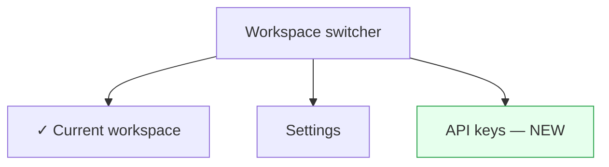
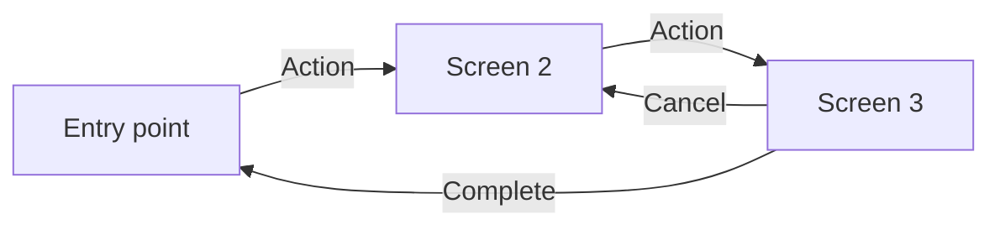
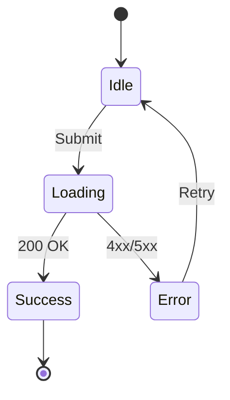

# Conditional SDD Sections

Loaded by the specify-solution skill only when the feature has a user interface or spans more than one
component or deployable. Add the matching section(s) to the Solution part of `spec.md` after **Runtime**; a feature that
needs neither leaves the Solution part as the template has it.

---

## User interface (when the feature has one)

Add a `### User interface` section covering:

- **Information architecture:** where the feature lives in navigation, how content is grouped, entry and exit points
- **Design system:** components used or extended, tokens, form / feedback / loading patterns
- **Interaction:** UI state and optimistic updates, feedback states, accessibility (WCAG level, keyboard, screen reader)

Prefer Mermaid over ASCII so it renders natively and stays editable.

Entry points as a tree:


Screen flows as a flowchart:


Component states as a state diagram:


---

## Multi-component (when the feature spans components, teams, or deployables)

Add a `### Multi-component` section covering:

- **Contracts:** which interfaces are public contracts that cannot break; breaking-change policy
- **Ownership:** which team owns which component; shared resources (databases, queues, caches)
- **Communication:** sync vs async, event-driven vs request-response; how components find each other per environment
- **Consistency:** eventual consistency, distributed transactions, sagas
- **Failure:** circuit breakers between components; correlation IDs and trace propagation
- **Shared code:** shared libraries, monorepo packages, code generation

Inter-component communication as a compact list:
```yaml
- from: source-component
  to: target-component
  protocol: REST | gRPC | queue
  contract: @docs/interfaces/internal-api.md
  data_flow: "what flows and when"
```

**Deployment coordination** — deploy order, minimum versions between components, feature flags for
rollout, rollback on partial failure, and the sequencing of data migrations across services.
