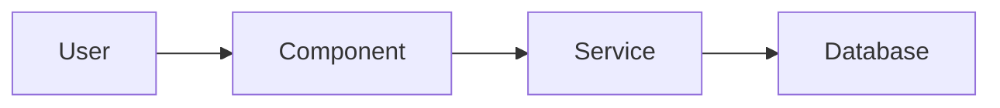
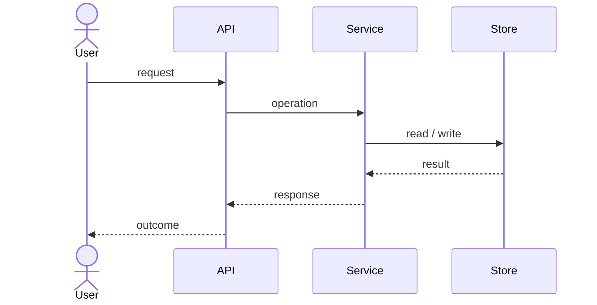

# Solution Design Document

> [!NOTE]
> This SDD answers **WHAT (design)** — the target architecture, components, interfaces, data
> changes, and the EARS behavior that makes "done" technical. It carries no code and no
> implementation sequencing (that is `/implement`'s job). Settled choices are **Decision** blocks;
> unresolved ones live in the **Open Questions** table at the foot of the document. Quality targets
> are the PRD's `NFR-N` gates — reference them, do not restate them.

## Approach

[NEEDS CLARIFICATION: One paragraph. The architecture pattern, how the feature integrates with the current system, and why this fits given the PRD's constraints. Add any purely technical constraint the PRD does not carry — language, framework, deployment restriction.]

- **Cross-cutting:** [one line each where relevant — security (authN/authZ, data protection), error handling strategy, performance (caching, batching, async), observability (what is logged, what is traced), i18n]
- **Deployment:** [NEEDS CLARIFICATION: "No change", or what changes — environment, configuration, feature flag, rollback]

## Read first

Context the implementer must read before building. Real paths only; one line on why each matters.

| Source | Why it matters |
|--------|----------------|
| [NEEDS CLARIFICATION: e.g. `docs/patterns/repository.md`] | [e.g. existing pattern this design follows] |
| [e.g. `src/claims/status.py`] | [e.g. the module being extended] |
| [e.g. `docs/interfaces/claims-core.md`] | [e.g. contract of the upstream API] |

## Boundaries

- **Must preserve:** [NEEDS CLARIFICATION: behavior and interfaces that cannot change]
- **Can modify:** [areas open for change or refactoring]
- **Must not touch:** [files or systems that are off-limits]

## Components

[NEEDS CLARIFICATION: The components this feature adds or changes and how they interact. Every PRD requirement is owned by exactly one component; no two components own the same domain logic.]



**Directory map** — where new code lands and existing code changes:

```
src/
├── feature_area/
│   ├── [discovered path]   # NEW: description
│   └── [discovered path]   # MODIFY: description
└── shared/
    └── [discovered path]   # MODIFY: description
```

## Interfaces & data

Only the deltas this feature introduces. Where a contract already has documentation, reference it instead of restating it.

**Interfaces** — every inbound and outbound path this feature adds or changes:

| Name | Direction | Type / format | Auth | Contract |
|------|-----------|---------------|------|----------|
| [NEEDS CLARIFICATION: e.g. `GET /api/v1/claims/{id}/status`] | inbound | HTTPS / JSON | session | [request and response shape, or `@docs/interfaces/...`] |
| [e.g. claims-core status lookup] | outbound | HTTPS / REST | API key | [`@docs/interfaces/claims-core.md`] |

**Schema changes** — omit when there are none:

```yaml
Table: existing_table
  ADD COLUMN: new_field (type, constraints)
  ADD INDEX: index_name (fields)

Table: new_table (NEW)
  id: primary key
  related_id: foreign key → existing_table.id
```

**Entities** — models created or changed, with the fields and behaviors that matter to the design:

```
ENTITY: PrimaryEntity (MODIFIED)
  + new_field: type
  + new_method(params): return_type
```

## Runtime

[NEEDS CLARIFICATION: The primary flow — what triggers it, what the system validates, what it does, what the user sees.]



**Error handling:**
- Invalid input: [message and user guidance]
- Upstream failure: [retry, fallback, or surfaced error]
- Business-rule violation: [feedback and recovery]

Where logic is non-obvious — a calculation, a conditional query, a retry policy — add a short example here using real schema names and a traced walkthrough with concrete rows. Guidance, not prescription.

## Decisions

Each settled, architecture-shaping choice is a **Decision** block with the options weighed and a confirmation checkbox. The checkbox is the machine-readable state (`[x]` = confirmed by the user).

> [!IMPORTANT]
> **Decision (ADR-1): [Decision name] → [Choice made]**
>
> | Option | Trade-off / why (not) |
> |--------|-----------------------|
> | **[Chosen option]** | [why this wins] |
> | [Alternative] | [why rejected] |
>
> **Rationale:** [Why this over alternatives] · **Accepts:** [trade-off we take on]
>
> - [ ] User confirmed

## Behavior

The technical "done": each critical PRD acceptance criterion translated into EARS statements the implementation must satisfy. Every `AC-N.M` has at least one statement; no statement invents behavior the PRD does not ask for.

Patterns: `THE SYSTEM SHALL` (always) · `WHEN [trigger], THE SYSTEM SHALL` (event) · `WHILE [state], THE SYSTEM SHALL` (state) · `IF [condition], THEN THE SYSTEM SHALL` (unwanted behavior) · `WHERE [feature enabled], THE SYSTEM SHALL` (optional).

**Main flow — [AC-N.M]:**
- [ ] WHEN [trigger], THE SYSTEM SHALL [expected behavior]
- [ ] THE SYSTEM SHALL [always-on requirement]

**Error handling — [AC-N.M]:**
- [ ] IF [invalid input], THEN THE SYSTEM SHALL [feedback]
- [ ] WHEN [upstream failure], THE SYSTEM SHALL [graceful handling]

**Edge cases — [AC-N.M]:**
- [ ] WHILE [boundary state], THE SYSTEM SHALL [correct behavior]

## Risks & gotchas

[NEEDS CLARIFICATION: What could make this design fail or trip up implementation — known limitations, technical debt in the touched area, race conditions, environment quirks, third-party surprises. One line each, or "None known".]

## Open questions

The single home for unresolved design decisions. Settled choices are Decision blocks above; anything still open lives here with a recommended default so implementation is not blocked. "None — all decisions settled." is a valid, good state.

| Question | Options | Recommended default | ☐ Resolved |
|----------|---------|---------------------|:----------:|
| [Open design decision?] | [Option A / Option B] | [Default + one-line why] | [ ] |
